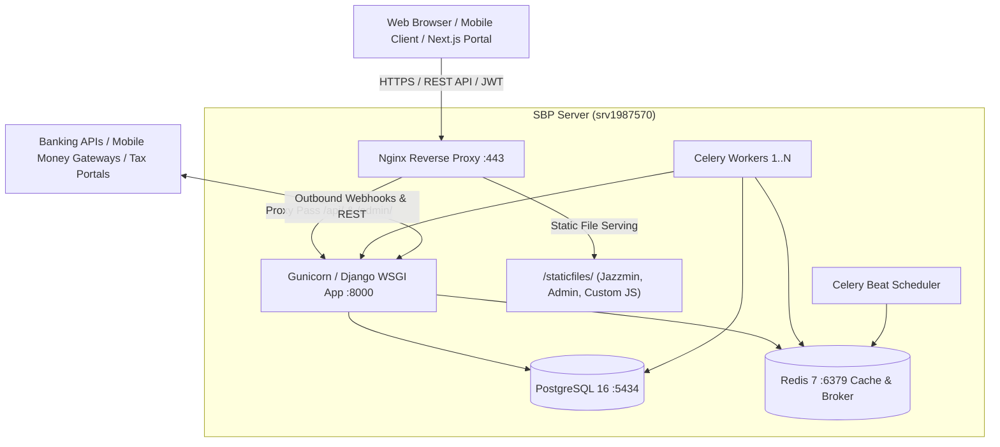
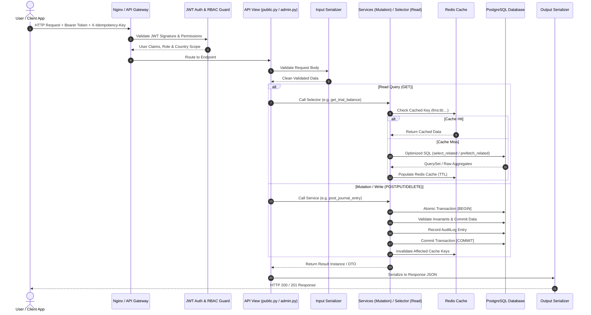

# SBP Africa Financial Management System (SBP-FMS)
## System Architecture & Technical Design Document

**Document Version:** 3.0.0  
**Target Environment:** Linux / Ubuntu LTS (Systemd + Nginx + Gunicorn)  
**Database:** PostgreSQL 16 (Port 5434)  
**Cache & Broker:** Redis 7 (Port 6379)  
**Python Runtime:** Python 3.12 / 3.13 / 3.14 via `uv`

---

## Table of Contents
1. [Executive Summary & Architectural Invariants](#1-executive-summary--architectural-invariants)
2. [High-Level Architecture Diagrams](#2-high-level-architecture-diagrams)
3. [Exhaustive Folder Architecture & Directory Mapping](#3-exhaustive-folder-architecture--directory-mapping)
4. [Internal App Design Pattern: The HackSoftware Architecture](#4-internal-app-design-pattern-the-hacksoftware-architecture)
5. [Domain Module Deep Dive](#5-domain-module-deep-dive)
6. [Core Architectural Subsystems](#6-core-architectural-subsystems)
   - [6.1 Multi-Tenancy & Country Scoping](#61-multi-tenancy--country-scoping)
   - [6.2 General Ledger Engine & Immutability](#62-general-ledger-engine--immutability)
   - [6.3 Enterprise RBAC & Segregation of Duties](#63-enterprise-rbac--segregation-of-duties)
   - [6.4 Idempotency & Financial Concurrency](#64-idempotency--financial-concurrency)
   - [6.5 Redis Caching & Invalidation Strategy](#65-redis-caching--invalidation-strategy)
   - [6.6 Asynchronous Task Engine (Celery & Celery Beat)](#66-asynchronous-task-engine-celery--celery-beat)
7. [API Design & Integration Layer](#7-api-design--integration-layer)
8. [Infrastructure, Deployment & Operations](#8-infrastructure-deployment--operations)

---

## 1. Executive Summary & Architectural Invariants

**SBP-FMS** is an enterprise-grade multi-tenant, multi-country financial management platform designed specifically for workforce outsourcing, Employer of Record (EOR), multi-currency accounting, and payroll escrow operations across Sub-Saharan Africa.

### Foundational Architectural Principles
* **Separation of Concerns (CQRS):** Complete segregation between read queries (`selectors.py`) and transactional state mutations (`services.py`).
* **Zero Business Logic in Views/Serializers:** Django REST Framework views and serializers are strictly HTTP translation mechanisms; they contain zero database mutation or calculation logic.
* **Double-Entry Invariant:** Every financial event produces balanced debit and credit entries ($\sum \text{Debits} = \sum \text{Credits}$).
* **Stateless API & Isolated Storage:** API servers remain stateless with JWT authentication; all session cache, message queuing, and rate limits reside in Redis.

---

## 2. High-Level Architecture Diagrams

### System Container Diagram (C4 Level 2)



### Request Lifecycle & Data Flow



---

## 3. Exhaustive Folder Architecture & Directory Mapping

The repository follows a clean, decoupled structure:

```text
sbp_fms_django_backend/
├── .env.example                     # Environment template for local development
├── .env.production                  # Production environment configuration
├── .gitignore                       # Git ignore definitions
├── Dockerfile                       # Multi-stage container build definition
├── Makefile                         # Unified operations CLI (run, test, migrate, logs)
├── pyproject.toml                   # Primary project dependencies & tool configs (uv/PEP 621)
├── uv.lock                          # Deterministic dependency lockfile
├── docker-compose.yml               # Local development stack (Postgres + Redis)
├── docker-compose.prod.yml          # Production container deployment stack
├── SOP.md                           # Standard Operating Procedures & User Manual
├── ARCHITECTURAL.md                 # This System Architecture Document
│
├── deploy/                          # Production Infrastructure & Automation
│   ├── gunicorn.service             # Systemd unit file for Gunicorn WSGI server
│   ├── celery-worker.service        # Systemd unit file for Celery worker processes
│   ├── celery-beat.service          # Systemd unit file for Celery beat periodic scheduler
│   ├── nginx.conf                   # High-performance Nginx reverse-proxy configuration
│   └── deploy.sh                    # Automated zero-downtime deployment script
│
├── logs/                            # Server, Celery, and application error logs
│
└── sbp_fms/                         # Main Django Project Root
    ├── manage.py                    # Django management script
    ├── pytest.ini                   # Pytest configuration & test markers
    ├── requirements.txt             # Production package requirements (Docker build fallback)
    ├── schema.yml                   # Pre-generated OpenAPI 3.0 schema
    │
    ├── config/                      # Project-Wide Settings & WSGI/ASGI Entrypoints
    │   ├── __init__.py
    │   ├── settings.py              # Modular Django settings (Security, DB, CORS, Cache)
    │   ├── urls.py                  # Top-level URL routing & Swagger endpoints
    │   ├── celery.py                # Celery application initialization & beat schedules
    │   ├── wsgi.py                  # WSGI entrypoint for Gunicorn
    │   └── asgi.py                  # ASGI entrypoint for async channels (if applicable)
    │
    ├── templates/                   # Custom Templates & Overrides
    │   └── admin/
    │       ├── base_site.html       # Customized Jazzmin admin base layout
    │       └── index.html           # High-contrast Executive Dashboard & Chart.js UI
    │
    ├── staticfiles/                 # Collected static assets for Nginx serving
    │
    └── apps/                        # Domain-Driven Micro-Applications (13 Apps)
        ├── organizations/           # Multi-tenancy, Subscription tiers & Organization profiles
        ├── users/                   # Custom User model, dynamic RBAC, JWT auth & Country scoping
        ├── ledger/                  # General Ledger, Chart of Accounts, Journals, Trial Balance
        ├── receivables/             # Accounts Receivable, Client Invoicing, Receipts, Aging
        ├── payables/                # Accounts Payable, Suppliers, Bills, 3-Way Match, Vouchers
        ├── payroll_escrow/          # Workforce Payroll batches, Client Escrow accounts, Payslips
        ├── treasury/                # Bank accounts, Statements, Reconciliation, 90-Day Cash Forecast
        ├── taxation/                # Tax regimes, VAT, WHT, Tax Invoices, Compliance filings
        ├── assets/                  # Fixed Asset register, Depreciation schedules, Disposals
        ├── consolidation/           # Multi-entity grouping, FX translation, Inter-company eliminations
        ├── budgeting/               # Budget allocation, Variance analysis, Department spending
        ├── contracts/               # Client & Vendor contracts, Milestones, Retainer agreements
        └── common/                  # Shared base models, Caching manager, Throttles, Celery tasks
```

---

## 4. Internal App Design Pattern: The HackSoftware Architecture

Every domain application inside `sbp_fms/apps/` strictly adheres to a uniform structural pattern:

```text
apps/<domain_module>/
├── __init__.py
├── apps.py                  # AppConfig & signal registration
├── admin.py                 # Custom Django Admin & Jazzmin interfaces
├── models.py                # Database entity definitions (ORM)
├── services.py              # Business logic & mutations (WRITE path)
├── selectors.py             # Filtered queries & aggregations (READ path)
├── serializers.py           # DRF input & output data validation
├── tests.py                 # Pytest test suite for this domain
├── migrations/              # Database schema migrations
└── api/                     # REST API Routing & ViewSets
    ├── __init__.py
    ├── urls.py              # Endpoint routing (public vs admin)
    ├── public.py            # Standard authenticated API endpoints
    └── admin.py             # Elevated superuser / managerial API endpoints
```

### Why this pattern?
1. **No Fat Models, No Fat Views:** Models only declare fields, indexes, and string representations. Views only validate incoming data and return JSON. All domain intelligence lives in pure, testable Python functions in `services.py` and `selectors.py`.
2. **Deterministic Side Effects:** When an operation in `services.py` executes, it wraps all database writes in `transaction.atomic()`, creates audit logs, and clears specific Redis cache tags.

---

## 5. Domain Module Deep Dive

### 1. `organizations` (Multi-Tenancy Foundation)
* **Responsibility:** Manages tenant organizations, subscription plans, platform billing, invitations, and membership.
* **Key Models:** `Organization`, `OrganizationInvitation`, `OrganizationMember`, `SubscriptionPlan`, `SubscriptionTransaction`.
* **Services:** `organization_create`, `plan_upgrade_service`, `invitation_send_service`.
* **Selectors:** `get_active_organizations`, `get_organization_metrics`.

### 2. `users` (Identity & RBAC)
* **Responsibility:** Custom email-based user model, dynamic RBAC (`Role`, `Permission`), country scope assignments, and JWT claims.
* **Key Models:** `User`, `Role`, `Permission`, `UserRole`, `RolePermission`.
* **Services:** `user_create`, `role_assign_service`, `permission_sync_service`.
* **Selectors:** `get_user_permissions`, `get_country_scoped_users`.

### 3. `ledger` (The Core Double-Entry Engine)
* **Responsibility:** The authoritative General Ledger, Chart of Accounts, Fiscal Years, Accounting Periods, and Financial Statements.
* **Key Models:** `Account`, `FiscalYear`, `AccountingPeriod`, `JournalEntry`, `JournalEntryLine`.
* **Services:** `journal_entry_create`, `journal_entry_post`, `journal_entry_reverse`, `period_close_service`.
* **Selectors:** `get_chart_of_accounts`, `get_trial_balance`, `get_balance_sheet`, `get_income_statement`.

### 4. `receivables` (Accounts Receivable)
* **Responsibility:** Customer profiles, billing terms, sales invoices, credit notes, customer payments, and debtor aging.
* **Key Models:** `Customer`, `SalesInvoice`, `InvoiceLine`, `SalesReceipt`, `CreditNote`.
* **Services:** `invoice_issue_service`, `receipt_allocate_service`, `credit_note_issue_service`.
* **Selectors:** `get_debtor_aging_report`, `get_overdue_invoices`.

### 5. `payables` (Accounts Payable)
* **Responsibility:** Suppliers, purchase orders, vendor bills, 3-way matching, payment vouchers, and creditor aging.
* **Key Models:** `Supplier`, `PurchaseOrder`, `SupplierInvoice`, `PaymentVoucher`, `DebitNote`.
* **Services:** `bill_create_service`, `voucher_approve_service`, `payment_disburse_service`.
* **Selectors:** `get_creditor_aging_report`, `get_pending_payment_vouchers`.

### 6. `payroll_escrow` (Workforce & Escrow Management)
* **Responsibility:** Client payroll escrow custody, payroll batch computation, statutory deduction rules, payslips, and mobile disbursements.
* **Key Models:** `EscrowAccount`, `EscrowDeposit`, `PayrollBatch`, `PayrollPayslip`, `StatutoryDeduction`.
* **Services:** `deposit_fund_escrow`, `payroll_batch_compute`, `payroll_batch_release`.
* **Selectors:** `get_escrow_balance`, `get_payroll_summary`.

### 7. `treasury` (Cash & Banking)
* **Responsibility:** Bank accounts, statement parsing, automated reconciliation, and 90-day cash flow liquidity forecasting.
* **Key Models:** `BankAccount`, `BankStatement`, `BankStatementLine`, `BankReconciliation`.
* **Services:** `statement_import_service`, `reconciliation_auto_match_service`.
* **Selectors:** `get_cash_flow_forecast`, `get_unreconciled_transactions`.

### 8. `taxation` (Statutory Tax Regimes)
* **Responsibility:** VAT, Withholding Tax (WHT), Corporate Tax, and statutory compliance schedules across operating jurisdictions.
* **Key Models:** `TaxAuthority`, `TaxCategory`, `TaxReturn`, `WithholdingCertificate`.
* **Services:** `tax_return_generate_service`, `wht_certificate_issue_service`.
* **Selectors:** `get_monthly_tax_liability`.

### 9. `assets` (Fixed Asset Register)
* **Responsibility:** Asset capitalization, depreciation schedules (Straight-line / Reducing Balance), revaluation, and disposal.
* **Key Models:** `FixedAsset`, `AssetCategory`, `DepreciationSchedule`.
* **Services:** `asset_capitalize_service`, `run_monthly_depreciation_service`.
* **Selectors:** `get_asset_net_book_value_register`.

### 10. `consolidation` (Multi-Entity Group Reporting)
* **Responsibility:** Inter-company eliminations, multi-currency foreign exchange revaluation (IAS 21), and consolidated group reports.
* **Key Models:** `ConsolidationGroup`, `EliminationEntry`, `ExchangeRate`.
* **Services:** `elimination_entry_create`, `run_group_consolidation_service`.
* **Selectors:** `get_consolidated_financial_statements`.

### 11. `budgeting` (Budgetary Control)
* **Responsibility:** Departmental budgets, cost center allocations, and real-time Budget vs Actual variance analytics.
* **Key Models:** `Budget`, `BudgetLine`, `Department`.
* **Services:** `budget_create_service`, `budget_lock_service`.
* **Selectors:** `get_budget_vs_actual_variance`.

### 12. `contracts` (Agreements & Retainers)
* **Responsibility:** Client and vendor contract tracking, billing milestones, and expiration notifications.
* **Key Models:** `Contract`, `ContractMilestone`, `ContractAttachment`.
* **Services:** `contract_activate_service`, `milestone_complete_service`.
* **Selectors:** `get_expiring_contracts`.

### 13. `common` (Core Foundation)
* **Responsibility:** Abstract base models (`TimeStampedModel`, `UUIDModel`, `AuditLog`), `CacheManager`, idempotency enforcement, and dashboard templatetags.

---

## 6. Core Architectural Subsystems

### 6.1 Multi-Tenancy & Country Scoping
Multi-tenancy in SBP-FMS operates at two distinct layers:
1. **Tenant Isolation:** All operational models inherit from `OrganizationTenantModel`, associating every record with an `organization_id`.
2. **Country Scoping (`CountryScopedAccess`):** Users operating at the country level (e.g. `GH`, `NG`, `KE`) are constrained by query filters:
   ```python
   # In selectors.py
   def get_invoices_for_user(user):
       qs = SalesInvoice.objects.filter(organization=user.organization)
       if not user.has_global_scope:
           qs = qs.filter(country=user.country_code)
       return qs
   ```

### 6.2 General Ledger Engine & Immutability
To guarantee audit compliance:
* **Draft vs Posted:** A journal is editable only while in `DRAFT` state.
* **Posting Check:**
  ```python
  total_debits = sum(line.debit for line in lines)
  total_credits = sum(line.credit for line in lines)
  if total_debits != total_credits:
      raise ValidationError("Debits must equal credits.")
  ```
* **Post Lock:** Once marked `POSTED`, the journal's lines are read-only.
* **Reversal Logic:** To undo a posted entry, the system issues a mirror `REVERSAL` journal referencing the original entry.

### 6.3 Enterprise RBAC & Segregation of Duties
* **Dynamic Permissions:** Permissions are strings formatted as `<module>:<action>` (e.g., `ledger:post`, `payroll:disburse`).
* **Segregation of Duties Enforcement:**
  ```python
  if voucher.created_by == request.user:
      raise PermissionDenied("The creator cannot approve this voucher (Maker-Checker violation).")
  ```

### 6.4 Idempotency & Financial Concurrency
* All payment, journal posting, and billing API calls support the `X-Idempotency-Key` header.
* The system caches the request hash in Redis for 24 hours. Duplicate requests with the same key immediately return the original HTTP response without re-executing business logic.

### 6.5 Redis Caching & Invalidation Strategy
* **Read-Heavy Caching:** Trial balances, Aging reports, and Dashboards are cached via `CacheManager` with key prefixes:
  - `fms:tb:{org_id}:{period}`
  - `fms:aging:{org_id}:{country}`
* **Automated Targeted Invalidation:** When a mutation service completes, it calls:
  ```python
  CacheManager.delete_pattern(f"fms:tb:{org_id}:*")
  ```

### 6.6 Asynchronous Task Engine (Celery & Celery Beat)
* **Message Broker:** Redis DB 0 (`redis://127.0.0.1:6379/0`).
* **Periodic Schedules (Celery Beat):**
  - Daily 00:00: FX rate synchronization across central banks.
  - Daily 01:00: Fixed asset depreciation check.
  - Weekly Monday 06:00: Inactive trial organization reminders.
  - Daily 04:00: Automated database snapshot backup.

---

## 7. API Design & Integration Layer

* **URL Structure:**
  - Standard User API: `/api/v1/<domain>/public/...`
  - Elevated Admin API: `/api/v1/<domain>/admin/...`
* **Documentation & Schemas:**
  - Interactive Swagger: `/api/docs/`
  - OpenAPI 3.0 YAML/JSON: `/api/schema/`
  - ReDoc Interface: `/api/redoc/`
* **Standard Response Envelope:**
  ```json
  {
    "success": true,
    "data": { ... },
    "error": null,
    "meta": {
      "timestamp": "2026-11-17T11:45:00Z",
      "version": "v1"
    }
  }
  ```

---

## 8. Infrastructure, Deployment & Operations

### Production Architecture on Host `srv1987570`
* **Operating System:** Ubuntu 22.04 LTS
* **Web Entrypoint:** Nginx terminating TLS certificates issued by Let's Encrypt for `fms.sbpafrica.group`.
* **Application Daemon:** Gunicorn running with 4 worker processes managed by Systemd (`deploy/gunicorn.service`).
* **Worker Daemon:** Celery worker running concurrency 4 managed by Systemd (`deploy/celery-worker.service`).
* **Scheduler Daemon:** Celery Beat managed by Systemd (`deploy/celery-beat.service`).
* **PostgreSQL:** Docker container `postgres:16-alpine` pinned to port `5434` (data volume persisted on host).
* **Redis:** Local / containerized Redis instance pinned to port `6379`.

### Operations Commands (`Makefile`)
```bash
make run              # Start local development server
make test             # Run pytest test suite
make test-fast        # Run pytest with fail-fast (-x)
make migrate          # Run Django database migrations
make makemigrations   # Detect model changes & create migrations
make collectstatic    # Collect static files for Nginx
make restart          # Restart Gunicorn, Celery worker & Celery beat
make logs             # Live stream journalctl systemd logs
make deploy           # Automated pull, migrate, collectstatic & restart
```

---
*End of System Architecture & Technical Design Document.*
