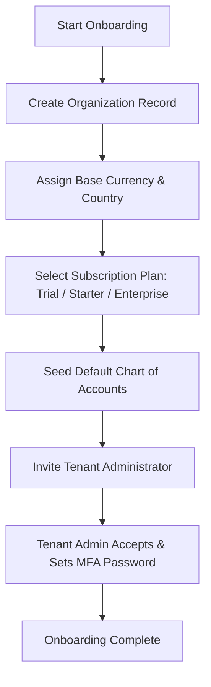
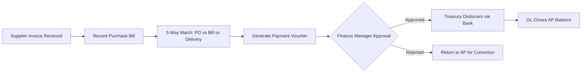

# SBP Africa Financial Management System (SBP-FMS)
## Standard Operating Procedures (SOP)

**Document Version:** 3.0.0  
**Effective Date:** November 2026  
**System Target:** SBP Africa Group Multi-Country Financial Management Platform  
**Operational Scope:** Ghana (`GH`), Nigeria (`NG`), Kenya (`KE`), and Francophone West Africa / UEMOA (`CI`, `BF`, `SN`)

---

## Table of Contents
1. [System Overview & Operating Principles](#1-system-overview--operating-principles)
2. [Roles, Responsibilities & Segregation of Duties](#2-roles-responsibilities--segregation-of-duties)
3. [Standard Operational Procedures (SOPs)](#3-standard-operational-procedures-sops)
   - [SOP-01: Tenant & Organization Onboarding](#sop-01-tenant--organization-onboarding)
   - [SOP-02: Chart of Accounts (COA) & General Ledger Management](#sop-02-chart-of-accounts-coa--general-ledger-management)
   - [SOP-03: Accounts Receivable (AR) & Client Billing](#sop-03-accounts-receivable-ar--client-billing)
   - [SOP-04: Accounts Payable (AP) & Supplier Disbursements](#sop-04-accounts-payable-ap--supplier-disbursements)
   - [SOP-05: Payroll Escrow & Workforce Disbursements](#sop-05-payroll-escrow--workforce-disbursements)
   - [SOP-06: Treasury, Bank Accounts & Reconciliation](#sop-06-treasury-bank-accounts--reconciliation)
   - [SOP-07: Fixed Assets & Depreciation Management](#sop-07-fixed-assets--depreciation-management)
   - [SOP-08: Tax Withholding & Statutory Filings](#sop-08-tax-withholding--statutory-filings)
   - [SOP-09: Multi-Entity Consolidation & Currency Translation](#sop-09-multi-entity-consolidation--currency-translation)
   - [SOP-10: Period-End Closing & Fiscal Year Closeout](#sop-10-period-end-closing--fiscal-year-closeout)
4. [How to Use the System](#4-how-to-use-the-system)
   - [4.1 Executive Admin Dashboard (Jazzmin UI)](#41-executive-admin-dashboard-jazzmin-ui)
   - [4.2 Interactive REST API & Swagger UI](#42-interactive-rest-api--swagger-ui)
   - [4.3 Frontend Web Application](#43-frontend-web-application)
5. [Audit Trails, Security & Incident Handling](#5-audit-trails-security--incident-handling)

---

## 1. System Overview & Operating Principles

The **SBP Africa Financial Management System (SBP-FMS)** is a cloud-based financial accounting, payroll escrow, and multi-entity consolidation platform. SBP-FMS serves as the central financial ledger and reporting hub for SBP Africa Group's workforce management and Employer of Record (EOR) operations across Sub-Saharan Africa.

### Fundamental Operating Invariants
1. **Double-Entry Bookkeeping:** Every transaction posted to the General Ledger must strictly satisfy:
   $$\sum \text{Debits} = \sum \text{Credits}$$
2. **Immutability of Posted Records:** Once a Journal Entry, Approved Invoice, or Disbursed Payroll Batch is finalized, it **cannot be updated or deleted**. Correction requires an explicit, audited Reversal or Credit/Debit Note.
3. **Escrow Solvency Rule:** Payroll disbursements can never exceed verified, cleared client escrow deposits.
4. **Multi-Tenant Isolation:** Transactions belonging to one tenant organization or subsidiary are strictly isolated by `organization_id` and country partition.

---

## 2. Roles, Responsibilities & Segregation of Duties

To safeguard company assets and comply with IFRS and local regulatory audits, SBP-FMS enforces strict **Segregation of Duties (Maker-Checker model)**:

| Role Title | System Role Code | Primary Responsibilities | Prohibited Actions |
| :--- | :--- | :--- | :--- |
| **Super Admin** | `SUPER_ADMIN` | Platform configuration, tenant provisioning, system parameters, emergency bypass. | Regular operational journal posting. |
| **Finance Manager** | `FINANCE_MANAGER` | Final approvals for payment vouchers, payroll releases, manual journals over limit, and period closes. | Cannot initiate payments or create journals they approve. |
| **Chief Accountant** | `CHIEF_ACCOUNTANT` | General Ledger oversight, Chart of Accounts maintenance, Trial Balance review, year-end closing. | Direct bank disbursement execution. |
| **AR Officer** | `AR_OFFICER` | Client invoicing, contract milestone billing, receipt allocation, debtor collection tracking. | Cannot modify supplier bank details or post vendor bills. |
| **AP Officer** | `AP_OFFICER` | Supplier verification, bill capture, 3-way matching, payment voucher preparation. | Cannot approve payment vouchers or release bank funds. |
| **Payroll Accountant** | `PAYROLL_ACCOUNTANT`| Gross-to-net payroll batch generation, statutory deduction calculations, payslip issuance. | Cannot disburse escrow funds directly. |
| **Treasury Officer** | `TREASURY_OFFICER` | Bank statement reconciliation, daily liquidity tracking, FX spot rate capture, payment execution. | Cannot create AP invoices or approve unverified vouchers. |
| **Internal Auditor** | `INTERNAL_AUDITOR` | System-wide audit inspection, compliance verification, forensic audit log analysis. | **Strictly Read-Only**; cannot post, edit, or approve anything. |
| **Country Accountant**| `COUNTRY_ACCOUNTANT`| Day-to-day transaction recording strictly scoped to their assigned operating country (`GH`, `NG`, `KE`, etc.). | Cannot view or access transactions outside their country. |

> [!IMPORTANT]
> **Segregation of Duties Enforcement:** The person who initiates (`created_by`) an invoice, payment voucher, or journal entry is programmatically blocked from approving (`approved_by`) that same record.

---

## 3. Standard Operational Procedures (SOPs)

### SOP-01: Tenant & Organization Onboarding
* **Actor:** Super Admin / System Administrator
* **Frequency:** As new subsidiaries or B2B SaaS clients join the platform.



1. **Navigate to:** `Admin > Organizations & Multi-Tenancy > Organizations > Add Organization`.
2. **Complete Fields:**
   - `Name`: Full legal corporate name.
   - `Slug`: Unique URL/API identifier (e.g., `sbp-kenya`).
   - `Country`: Primary ISO country code (`GH`, `KE`, `NG`, etc.).
   - `Base Currency`: Functional reporting currency (`GHS`, `KES`, `NGN`, `USD`).
   - `Is In-House`: Check if this is an internal SBP subsidiary; uncheck for external B2B clients.
3. **Assign Subscription:** Assign appropriate plan tier (`TRIAL`, `STARTER`, `GROWTH`, `ENTERPRISE`).
4. **Provision Initial User:** Create the organization owner under `Organization Invitations` or assign an existing user as `Tenant Admin`.
5. **Verification:** Confirm that default system accounts (Cash, AR, AP, Retained Earnings) are automatically initialized.

---

### SOP-02: Chart of Accounts (COA) & General Ledger Management
* **Actor:** Chief Accountant (Initiator) / Finance Manager (Approver)
* **Frequency:** Ongoing setup and month-end journal entries.

#### Account Coding Structure
* `1000 - 1999`: **Assets** (Current, Non-Current, Bank, Accounts Receivable)
* `2000 - 2999`: **Liabilities** (Current, Accounts Payable, Accruals, Tax Liabilities)
* `3000 - 3999`: **Equity** (Share Capital, Retained Earnings, Currency Translation Reserve)
* `4000 - 4999`: **Revenue** (Service Fees, Management Fees, Reimbursable Revenue)
* `5000 - 5999`: **Cost of Sales / Direct Workforce Costs** (Direct Salaries, Statutory Social Security)
* `6000 - 7999`: **Operating Expenses** (Rent, Utilities, IT, Depreciation)

#### Creating a Manual Journal Entry
1. Navigate to: `Admin > General Ledger > Journal Entries > Add Journal Entry`.
2. Specify `Entry Number`, `Date`, `Fiscal Year`, and `Accounting Period`.
3. Enter line items ensuring:
   - Every line specifies `Account`, `Debit Amount` OR `Credit Amount`, and `Description`.
   - Optional: Tag `Cost Centre` or `Department` for analytical budgeting.
4. **Balance Check:** System will reject posting if $\sum \text{Debits} \ne \sum \text{Credits}$.
5. Click **Submit for Approval**.
6. The **Finance Manager** reviews lines and selects **Post Journal Entry**.
7. Once posted, the journal is locked and automatically updates real-time Trial Balance caches.

---

### SOP-03: Accounts Receivable (AR) & Client Billing
* **Actor:** Accounts Receivable Officer
* **Frequency:** Monthly billing cycles or per contract milestone.

1. **Verify Contract & Rates:** Ensure client master profile has active billing rates, currency, and payment terms (e.g., Net 15, Net 30).
2. **Draft Client Invoice:**
   - Navigate to `Admin > Accounts Receivable > Sales Invoices > Add Invoice`.
   - Select `Customer`, `Invoice Date`, `Due Date`, and `Currency`.
   - Add line items (e.g., "Workforce Management Fees - Month", "Reimbursable Travel").
   - System applies standard tax codes (e.g., standard VAT rate).
3. **Review & Issue:**
   - Click **Issue Invoice**. The system assigns a sequential invoice reference (e.g., `INV-2026-0012`).
   - Automatically generates a balanced GL Journal Entry:
     - **Debit:** Accounts Receivable (`1200`)
     - **Credit:** Fee Revenue (`4000`)
     - **Credit:** Output VAT Payable (`2200`)
4. **Payment Receipt Allocation:**
   - When client payment is received via bank transfer, navigate to `Sales Receipts > Add Receipt`.
   - Match receipt against open invoice(s). System marks invoice `PAID` or `PARTIALLY_PAID` and credits AR.

---

### SOP-04: Accounts Payable (AP) & Supplier Disbursements
* **Actor:** Accounts Payable Officer (Maker) & Finance Manager (Checker)
* **Frequency:** Daily / Weekly payment batches.



1. **Bill Capture:** Record supplier bill under `Accounts Payable > Supplier Invoices`. Enter vendor invoice reference, tax identification, and line items.
2. **3-Way Matching:** Attach Purchase Order reference and receiving documentation.
3. **Payment Voucher Preparation:**
   - AP Officer creates a `Payment Voucher` for due invoices.
   - Verifies withholding tax (WHT) deductions applicable to supplier services.
4. **Approval & Payment:**
   - Finance Manager reviews bank beneficiary details and approves voucher.
   - Treasury Officer initiates bank transfer and marks voucher `DISBURSED`.
   - Automated GL Posting:
     - **Debit:** Accounts Payable (`2000`)
     - **Credit:** Withholding Tax Payable (`2250`)
     - **Credit:** Bank Operating Account (`1010`)

---

### SOP-05: Payroll Escrow & Workforce Disbursements
* **Actor:** Payroll Accountant & Treasury Officer
* **Frequency:** Monthly payroll runs (20th–28th of each month).

> [!CAUTION]
> **Zero-Unfunded-Disbursement Policy:** Never release payroll without verified client escrow deposits in the designated escrow account.

1. **Client Escrow Funding Verification:**
   - Query client escrow balance under `Payroll Escrow > Escrow Accounts`.
   - Confirm deposit receipt: Client gross invoice + statutory obligations + management fee must be cleared in the bank.
2. **Generate Payroll Batch:**
   - Navigate to `Payroll Batches > Create Batch`.
   - Select Country (`GH`, `KE`, `NG`, `CI`), Operating Period, and Client Entity.
   - Compute gross earnings, statutory social security (e.g., SSNIT in Ghana, NSSF in Kenya), PAYE income tax, and net pay.
3. **Internal Review:** Verify totals against statutory country rate tables.
4. **Approval & Release:**
   - Finance Manager approves the payroll batch.
   - Treasury Officer initiates batch mobile money / bank payments to workforce.
   - Escrow ledger balance automatically deducts the net wages and statutory allocations.

---

### SOP-06: Treasury, Bank Accounts & Reconciliation
* **Actor:** Treasury Officer
* **Frequency:** Daily cash monitoring, Weekly/Monthly formal reconciliation.

1. **Bank Statement Import:**
   - Upload official bank statements (CSV or MT940 format) under `Treasury > Bank Statements`.
2. **Automated & Manual Matching:**
   - System runs fuzzy matching between bank transaction rows and recorded receipts/vouchers.
   - For unmatched bank fees or interest, record manual balancing transactions directly.
3. **Reconciliation Sign-Off:**
   - Compare Bank Balance vs General Ledger Book Balance:
     $$\text{Bank Statement Balance} \pm \text{Outstanding Checks/Deposits} = \text{GL Cash Account Balance}$$
   - Confirm variance is `0.00` and generate the signed **Bank Reconciliation Statement**.
4. **90-Day Cash Flow Forecasting:**
   - Review `/api/v1/treasury/public/forecast/` weekly to alert executive management of upcoming liquidity shortfalls across currency tiers.

---

### SOP-07: Fixed Assets & Depreciation Management
* **Actor:** Chief Accountant
* **Frequency:** Monthly on the 28th.

1. **Capitalization:** Record newly acquired equipment/vehicles under `Assets > Fixed Assets`.
   - Enter Asset Code, Serial Number, Useful Life (months), Salvage Value, and Depreciation Method (`STRAIGHT_LINE` or `REDUCING_BALANCE`).
2. **Monthly Depreciation Run:**
   - Trigger the automated depreciation engine (`Run Monthly Depreciation`).
   - The system calculates monthly expense and automatically posts:
     - **Debit:** Depreciation Expense (`6500`)
     - **Credit:** Accumulated Depreciation (`1590`)
3. **Disposal or Impairment:**
   - When an asset is sold, scrapped, or impaired, record disposal proceeds to calculate and post Gain/Loss on Disposal.

---

### SOP-08: Tax Withholding & Statutory Filings
* **Actor:** Country Accountant & Finance Manager
* **Frequency:** Monthly (by statutory deadline, e.g., 15th of following month).

1. **Generate Tax Schedule:**
   - Under `Taxation > Tax Returns`, select country tax jurisdiction and period.
   - Extract Value Added Tax (VAT) inputs/outputs and Withholding Tax (WHT) deducted at source.
2. **Statutory Filing & Remittance:**
   - Prepare local tax authority filing documents (e.g., GRA in Ghana, KRA iTax in Kenya, FIRS in Nigeria).
   - Generate Payment Voucher for the tax authority and execute remittance before deadline to prevent penalties.
3. **Issue WHT Certificates:**
   - Issue automated WHT deduction certificates to vendors from the system.

---

### SOP-09: Multi-Entity Consolidation & Currency Translation
* **Actor:** Group Finance Manager
* **Frequency:** Monthly and Quarterly Group Reporting.

1. **Verify Subsidiary Trial Balances:** Ensure all local operating subsidiaries have closed their individual monthly books.
2. **Inter-Company Eliminations:**
   - Record inter-company loan repayments, management fee charges, and cross-border invoicing under `Consolidation > Intercompany Eliminations`.
   - System cancels matching debit/credit entries to prevent double-counting.
3. **Foreign Exchange Translation (IAS 21):**
   - Configure month-end closing spot rates and average monthly rates under `Consolidation > FX Rates`.
   - Non-USD subsidiary assets and liabilities are translated at closing rate; income statements translated at average rate.
   - Translation differences are routed to the **Foreign Currency Translation Reserve (FCTR)** in Equity.
4. **Generate Group Financials:** Produce Consolidated Balance Sheet, Income Statement, and Cash Flow Statement.

---

### SOP-10: Period-End Closing & Fiscal Year Closeout
* **Actor:** Chief Accountant & Finance Manager
* **Frequency:** Monthly cut-off and Annual Year-End.

1. **Closing Checklist:**
   - [ ] All bank reconciliations complete with zero unresolved variance.
   - [ ] All supplier bills entered and approved.
   - [ ] Client invoicing complete for all billable contracts.
   - [ ] Payroll batches disbursed and tax accruals posted.
   - [ ] Monthly fixed asset depreciation executed.
2. **Lock Period:** Under `Ledger > Accounting Periods`, update status to `CLOSED`.
   - Once `CLOSED`, no user can post backdated journals into this period without Super Admin unlock.
3. **Year-End P&L Net Out:** At the end of Period 12, the system runs the Year-End Close service:
   - Summarizes all Revenue (`4xxx`) and Expense (`5xxx-7xxx`) balances to zero.
   - Transfers net profit/loss into `3200 - Retained Earnings`.

---

## 4. How to Use the System

### 4.1 Executive Admin Dashboard (Jazzmin UI)
* **Access URL:** `https://fms.sbpafrica.group/admin/`
* **Intended For:** Super Admins, Finance Managers, Chief Accountants, Auditors, and Operations Staff.

1. **Logging In:**
   - Navigate to `/admin/login/`.
   - Enter your corporate email and secure password.
2. **Dashboard Overview:**
   - **Executive Header:** Displays system health, live telemetry, and direct links to API documentation.
   - **KPI Metric Cards:** Instant real-time counts of Total Active Tenants, Platform Users, Active Subscription Plans, and Engine Status.
   - **Interactive Visualizations:**
     - *Tenants by Plan Tier:* Doughnut chart showing distribution across trial, paid, and exempt subsidiaries.
     - *Platform Growth Trends:* Growth curves of tenant and user onboarding over the past 6 months.
     - *Financial Domain Modules:* Volume metrics across all 11 core financial apps.
   - **Sidebar Navigation:** Access all 11 domain apps grouped logically (User Management, Organizations, General Ledger, Accounts Receivable, Accounts Payable, Payroll Escrow, Treasury, Taxation, Assets, Consolidation, Budgeting, Contracts).
3. **Filtering & Searching:**
   - Every model list page includes breadcrumb search bars, date range filters, country dropdowns, and status filters.

---

### 4.2 Interactive REST API & Swagger UI
* **Swagger UI:** `https://fms.sbpafrica.group/api/docs/`
* **ReDoc UI:** `https://fms.sbpafrica.group/api/redoc/`
* **Raw Schema:** `https://fms.sbpafrica.group/api/schema/`
* **Intended For:** Frontend engineers, third-party banking integrations, and automation scripts.

1. **Authentication Flow:**
   - Execute `POST /api/v1/users/public/login/` with:
     ```json
     {
       "email": "user@sbpafrica.group",
       "password": "<your-password>"
     }
     ```
   - Receive JWT `access` and `refresh` tokens.
2. **Authorizing in Swagger:**
   - Click the green **Authorize** button in Swagger UI.
   - Enter `Bearer <your_access_token>`.
3. **Idempotency Keys:**
   - For all financial mutation endpoints (`POST /api/v1/ledger/...`, `POST /api/v1/payables/...`), supply a unique header:
     `X-Idempotency-Key: <unique-uuid>`
   - Prevents duplicate debit/credit postings in the event of network retries.

---

### 4.3 Frontend Web Application
* **Development URL:** `http://localhost:3000` or `http://localhost:3001`
* **Production URL:** `https://fms.sbpafrica.group/app/`
* **Intended For:** Client portal users, field officers, and standard accounting staff.

1. Fully decoupled React / Next.js single-page application.
2. Automatically sends JWT tokens in the `Authorization` header and handles token refresh silently.
3. Provides user-friendly wizards for Invoice Generation, Payroll Entry, and Expense Submissions.

---

## 5. Audit Trails, Security & Incident Handling

### Audit Logs
* Every mutation (create, edit, delete, approve, reverse) automatically generates an unalterable `AuditLog` entry in the database.
* Audit records log:
  - Timestamp (UTC)
  - User ID and Email
  - IP Address and User-Agent
  - Entity Name & Primary Key
  - Action Type (`CREATE`, `UPDATE`, `DELETE`, `APPROVE`)
  - Full before-and-after JSON delta payloads.

### Incident Handling & Security Procedures
1. **Compromised Credentials:**
   - Super Admin immediately deactivates the user under `Admin > Users > [Target User] > Uncheck Is Active`.
   - Blacklist all active JWT refresh tokens.
2. **Posting Error Correction:**
   - Never attempt raw database edits.
   - Record a formal **Reversal Journal Entry** referencing the original transaction ID with approval from the Finance Manager.
3. **System Health & Monitoring:**
   - Health check endpoint: `https://fms.sbpafrica.group/health/`
   - Monitors Database connectivity, Redis Cache ping, and Celery worker heartbeats.

---
*End of Standard Operating Procedures.*
