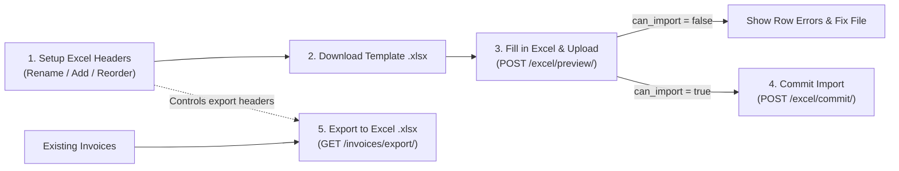

# SBP-FMS Invoicing Excel — Frontend Integration Guide

> **Target Audience**: Frontend Engineers  
> **Base Path**: `/api/v1/invoicing/`  
> **Required Headers**:
> * `Authorization: Bearer <JWT_ACCESS_TOKEN>`
> * `X-Organization-ID: <ORGANIZATION_UUID_OR_SLUG>`
> * `Idempotency-Key: <UUID>` *(recommended on `POST`/`PUT` calls)*

---

## 1. Overview of User Flows

The frontend needs to support **four connected capabilities** under **Invoicing**:

1. **Customize Excel Headers (`Excel Template Setup`)**:
   * Users can rename column headers (e.g. change `Client Code or Name` → `Customer ID`), reorder columns, add custom columns (e.g. `Mine Site`, `Shift`, `PO Ref`), or remove optional columns.
   * Users can save multiple templates per organization and mark one as default.
2. **Download Excel Import Template (`.xlsx`)**:
   * Downloads a styled `.xlsx` workbook with the user's customized headers in Row 1, a guided sample row in Row 2, and an `Instructions` sheet.
3. **Upload Excel & Preview → Commit (`Bulk Invoice Import`)**:
   * **Step 1 (Upload & Dry-Run Preview)**: User selects an `.xlsx` file (and optional `template_id`), uploads via `multipart/form-data`, and sees a live validation table showing `valid_rows_count`, `error_rows_count`, row-by-row errors, and `unmapped_headers`.
   * **Step 2 (Commit)**: If `can_import === true`, user clicks **"Import Invoices"** to atomically create the invoices (multi-line invoices sharing the same `invoice_number` are automatically grouped, and Ghana statutory taxes are calculated).
4. **Download / Export Existing Invoices to Excel (`.xlsx`)**:
   * Exports filtered invoices into an `.xlsx` file formatted using either the user's default `INVOICE` Excel template or a selected `?template_id=...`.



---

## 2. TypeScript Interfaces

```typescript
export type ColumnDataType = 'string' | 'number' | 'date' | 'choice';

export interface ExcelColumnSchema {
  header_name: string;        // Column title shown in Row 1 of Excel (e.g. "Customer ID")
  field_key: string;          // Unique key (system key OR custom key like "site_name")
  system_field: string;       // Backend system field key, or "" for custom columns
  data_type: ColumnDataType;
  choices?: string[];         // Allowed values when data_type === 'choice'
  is_required: boolean;
  default_value?: any;
  description?: string;
  is_custom: boolean;         // true if user added this column
  sample_value?: any;
}

export interface InvoiceExcelTemplate {
  id: string;                 // UUID
  organization: string | null;
  name: string;
  entity_type: 'INVOICE';
  entity_type_display: string;
  description: string;
  columns_schema: ExcelColumnSchema[];
  columns_count: number;
  is_default: boolean;
  created_at: string;
  updated_at: string;
}

export interface ImportRowError {
  row: number;
  column: string;
  error: string;
}

export interface InvoiceExcelPreviewResponse {
  job_id: string;             // UUID to pass to /excel/commit/
  template_id: string;
  template_name: string;
  entity_type: 'INVOICE';
  file_name: string;
  total_rows: number;
  valid_rows_count: number;
  error_rows_count: number;
  can_import: boolean;
  errors: ImportRowError[];
  unmapped_headers: string[];
  preview_rows: Array<{
    row_number: number;
    fields: Record<string, any>;
    extra_data: Record<string, any>;
    is_valid: boolean;
  }>;
  _validated_data: Array<{
    row_number: number;
    fields: Record<string, any>;
    extra_data: Record<string, any>;
  }>;
}
```

---

## 3. API Endpoints & Payloads

### 3.1. Excel Header Setup (Templates)

| Method | Endpoint | Purpose |
| :--- | :--- | :--- |
| `GET` | `/api/v1/invoicing/excel/templates/` | List all `INVOICE` Excel templates (auto-creates system default on first call). |
| `POST` | `/api/v1/invoicing/excel/templates/` | Create a new custom Excel header template. |
| `GET` | `/api/v1/invoicing/excel/templates/{template_id}/` | Get a specific template's `columns_schema`. |
| `PUT` | `/api/v1/invoicing/excel/templates/{template_id}/` | Update headers (rename `header_name`, add custom columns, delete optional columns, reorder array). |
| `DELETE` | `/api/v1/invoicing/excel/templates/{template_id}/` | Delete a custom template. |
| `POST` | `/api/v1/invoicing/excel/templates/reset-default/` | Reset the default template back to system default headers. |

#### Mandatory System Fields (`system_field`)
When users customize columns, the following **5 required system fields** must remain mapped (or have a non-empty `default_value`):
1. `client_code` — Existing Customer Code (e.g. `CL-001`) or exact Customer Name
2. `issue_date` — Date (`YYYY-MM-DD`)
3. `due_date` — Date (`YYYY-MM-DD`)
4. `line_description` — Service/product line description
5. `quantity` — Number (`> 0`)
6. `unit_price` — Number (`>= 0`)

*(All other system fields — `invoice_number`, `invoice_type`, `currency`, `reference_number`, `unit_of_measurement`, `discount_amount`, `tax_code`, `notes` — are optional and can be deleted or renamed freely.)*

#### Example: Create Custom Header Setup (`POST /api/v1/invoicing/excel/templates/`)
```json
{
  "name": "Mining Operations Invoice Format",
  "description": "Custom Excel headers with Mine Site column",
  "is_default": true,
  "columns_schema": [
    { "header_name": "Inv Ref", "field_key": "invoice_number", "system_field": "invoice_number", "data_type": "string", "is_required": false, "is_custom": false },
    { "header_name": "Customer ID", "field_key": "client_code", "system_field": "client_code", "data_type": "string", "is_required": true, "is_custom": false },
    { "header_name": "Bill Date", "field_key": "issue_date", "system_field": "issue_date", "data_type": "date", "is_required": true, "is_custom": false },
    { "header_name": "Pay By", "field_key": "due_date", "system_field": "due_date", "data_type": "date", "is_required": true, "is_custom": false },
    { "header_name": "Service Details", "field_key": "line_description", "system_field": "line_description", "data_type": "string", "is_required": true, "is_custom": false },
    { "header_name": "Qty", "field_key": "quantity", "system_field": "quantity", "data_type": "number", "is_required": true, "is_custom": false },
    { "header_name": "Rate", "field_key": "unit_price", "system_field": "unit_price", "data_type": "number", "is_required": true, "is_custom": false },
    { "header_name": "Mine Site", "field_key": "site_name", "system_field": "", "data_type": "string", "is_required": false, "is_custom": true }
  ]
}
```

---

### 3.2. Download Excel Import Template

```http
GET /api/v1/invoicing/excel/template/download/?template_id=<OPTIONAL_UUID>
```
* **Response**: Binary `.xlsx` file (`Content-Type: application/vnd.openxmlformats-officedocument.spreadsheetml.sheet`).
* **Frontend Implementation**: Fetch as `blob` (`responseType: 'blob'`), create an object URL, and trigger `<a download="invoice_import_template.xlsx">`.

---

### 3.3. Upload & Dry-Run Preview

```http
POST /api/v1/invoicing/excel/preview/
Content-Type: multipart/form-data
```
**Form Data Fields**:
* `file` *(required)*: `.xlsx` or `.csv` file
* `template_id` *(optional)*: UUID of the selected `InvoiceExcelTemplate` (uses default if omitted)

**Response (`200 OK`)**:
```json
{
  "status": "success",
  "message": "Invoice Excel preview completed. Review validation summary before committing.",
  "data": {
    "job_id": "7a8b9c0d-1111-2222-3333-444455556666",
    "template_id": "...",
    "template_name": "Mining Operations Invoice Format",
    "entity_type": "INVOICE",
    "file_name": "invoices_batch.xlsx",
    "total_rows": 2,
    "valid_rows_count": 2,
    "error_rows_count": 0,
    "can_import": true,
    "errors": [],
    "unmapped_headers": [],
    "preview_rows": [
      {
        "row_number": 2,
        "fields": {
          "invoice_number": "INV-XLS-001",
          "client_code": "CLI-GOLD-001",
          "issue_date": "2026-11-26",
          "due_date": "2026-12-26",
          "line_description": "Rig Maintenance",
          "quantity": "10",
          "unit_price": "500"
        },
        "extra_data": { "site_name": "Tarkwa" },
        "is_valid": true
      }
    ],
    "_validated_data": [ ... ]
  }
}
```

---

### 3.4. Commit Validated Upload

```http
POST /api/v1/invoicing/excel/commit/
Content-Type: application/json
```
**Request Body**:
```json
{
  "job_id": "7a8b9c0d-1111-2222-3333-444455556666",
  "validated_rows": [ ... ] // Pass data._validated_data from preview response
}
```
* **Response (`201 Created`)**:
```json
{
  "status": "success",
  "message": "Successfully imported 1 INVOICE records.",
  "data": {
    "job_id": "7a8b9c0d-1111-2222-3333-444455556666",
    "status": "COMPLETED",
    "entity_type": "INVOICE",
    "imported_count": 1,
    "message": "Successfully imported 1 INVOICE records."
  }
}
```
> **Note on Multi-Line Invoices**: Rows sharing the same `invoice_number` (e.g. 2 rows with `INV-XLS-001`) are automatically grouped into **1 invoice with 2 line items**. Rows with an empty `invoice_number` each create a separate invoice with an auto-generated number.

---

### 3.5. Download / Export Existing Invoices to Excel

```http
GET /api/v1/invoicing/invoices/export/?template_id=<OPTIONAL_UUID>&status=ISSUED&client_id=<UUID>&start_date=2026-01-01&end_date=2026-12-31
```
*(Also aliased at `GET /api/v1/invoicing/excel/export/`)*

**Optional Query Parameters**:
* `template_id` — Controls the exact Excel column headers, custom fields, and column order in the exported `.xlsx`. If omitted, uses the organization's default `INVOICE` template (or system default).
* `status` — `DRAFT`, `ISSUED`, `PAID`, `OVERDUE`, `VOIDED`, etc.
* `invoice_type` — `STANDARD`, `PROFORMA`, `CREDIT_NOTE`, `DEBIT_NOTE`
* `client_id` — Filter by client UUID
* `category_id` — Filter by invoice category UUID
* `start_date` / `end_date` — Filter `issue_date` range (`YYYY-MM-DD`)
* `search` — Search by invoice number, PO reference, or client name

**Response**: Binary `.xlsx` file (`invoices_export.xlsx`). Download via `responseType: 'blob'`.

---

## 4. What the Frontend Developer Needs to Build

1. **Invoicing Toolbar Buttons** (on `/invoicing` list page):
   * **"Export Excel"**: Calls `GET /api/v1/invoicing/invoices/export/` (passing current active table filters + selected `template_id`) and triggers `.xlsx` file download.
   * **"Import from Excel"**: Opens the Bulk Invoice Import modal/drawer.
2. **Excel Header Setup Modal / Tab**:
   * Fetches `GET /api/v1/invoicing/excel/templates/`.
   * Displays an editable list of columns (`columns_schema`):
     * **Header Name** input (editable for all columns)
     * **Required** badge (locks deletion for the 6 mandatory system fields)
     * **Delete** button (for optional & custom columns)
     * **Move Up / Down** buttons (to reorder Excel columns)
     * **"+ Add Custom Column"** form (`header_name`, `field_key` auto-slugified, `data_type`, `is_custom: true`, `system_field: ""`)
     * **"Reset to Defaults"** button (`POST /api/v1/invoicing/excel/templates/reset-default/`)
   * Saves via `PUT /api/v1/invoicing/excel/templates/{id}/` (or `POST` for a new preset).
3. **Bulk Import Wizard (Inside "Import from Excel" Modal)**:
   * **Step 1**: Template selector + **"Download Excel Template"** button (`GET /api/v1/invoicing/excel/template/download/?template_id=...`).
   * **Step 2**: Drag-and-drop `.xlsx` file uploader → calls `POST /api/v1/invoicing/excel/preview/`.
   * **Step 3 (Preview & Validation)**:
     * Summary badges: Total Rows, Valid Rows, Errors.
     * If `errors.length > 0`, show a red error table (`Row #`, `Column`, `Error Message`) and disable the Commit button.
     * Show `preview_rows` table with `fields` + `extra_data`.
   * **Step 4 (Commit)**: Clicking **"Confirm & Import"** sends `{ job_id, validated_rows: _validated_data }` to `POST /api/v1/invoicing/excel/commit/`, then refreshes the invoices list.
