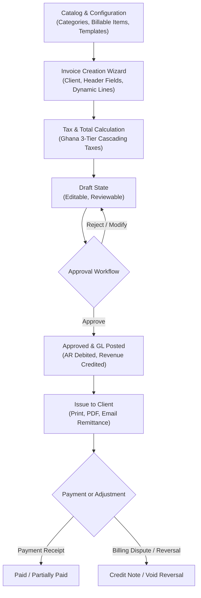

# SBP-FMS Invoicing Module — Frontend Integration Specification

> **Target Audience**: Frontend Engineers (React, Next.js, Vue, or Mobile UI developers).  
> **Base Path**: `/api/v1/invoicing/`  
> **Authentication**: `Authorization: Bearer <JWT_ACCESS_TOKEN>`  
> **Tenant Header**: `X-Organization-ID: <ORGANIZATION_UUID_OR_SLUG>` (or automatic JWT tenant context)  
> **Idempotency**: `Idempotency-Key: <UUID>` (recommended on all mutating `POST`/`PUT` requests)

---

## 1. High-Level Architecture & Workflows

The Invoicing module provides an end-to-end billing engine tailored for enterprise services, workforce outsourcing, management consulting, haulage, and general commercial trade across Africa.



---

## 2. Global Enums & Data Types (TypeScript Definitions)

```typescript
// Invoice Document Types
export type InvoiceType = 'STANDARD' | 'PROFORMA' | 'CREDIT_NOTE' | 'DEBIT_NOTE';

// Lifecycle Statuses
export type InvoiceStatus =
  | 'DRAFT'
  | 'PENDING_APPROVAL'
  | 'APPROVED'
  | 'ISSUED'
  | 'PARTIALLY_PAID'
  | 'PAID'
  | 'OVERDUE'
  | 'CANCELLED'
  | 'VOIDED';

// Template Layout Styles
export type InvoiceLayoutStyle =
  | 'MODERN'
  | 'CLASSIC'
  | 'CORPORATE'
  | 'MINIMAL'
  | 'DETAILED_STAFFING';

// Recurring Frequencies
export type RecurringFrequency =
  | 'WEEKLY'
  | 'BI_WEEKLY'
  | 'MONTHLY'
  | 'QUARTERLY'
  | 'SEMI_ANNUALLY'
  | 'ANNUALLY';

// Dynamic Custom Field Type Definition
export interface CustomFieldDefinition {
  key: string;               // e.g. "po_number", "site_location", "hours_worked"
  label: string;             // e.g. "PO Number", "Mine Site Location", "Hours"
  type: 'string' | 'number' | 'date' | 'select' | 'boolean';
  required: boolean;
  placeholder?: string;
  default_value?: any;
  options?: string[];        // For select dropdowns e.g. ["Obuasi", "Tarkwa", "Ahafo"]
}

// Invoice Line Item Input
export interface InvoiceLineInput {
  item_id?: string | null;           // UUID of BillableItem catalog (optional)
  description: string;               // Line narrative
  quantity: number;                  // e.g. 1.00, 160.00
  unit_of_measurement: string;       // e.g. "Unit", "Hours", "Days", "Month"
  unit_price: number;                // Base price per unit
  discount_amount?: number;          // Flat discount on this line
  tax_code?: string;                 // e.g. "VAT_STANDARD", "EXEMPT", "ZERO"
  tax_rate?: number;                 // e.g. 0.1500 (15%)
  custom_fields?: Record<string, any>; // Dynamic column values configured by template
  revenue_account_id?: string | null;// Specific GL revenue override (optional)
}

// Invoice Creation Payload
export interface InvoiceCreatePayload {
  client_id: string;                 // UUID of Client
  issue_date: string;                // YYYY-MM-DD
  due_date: string;                  // YYYY-MM-DD
  invoice_type?: InvoiceType;        // Defaults to 'STANDARD'
  category_id?: string | null;       // UUID of InvoiceCategory
  template_id?: string | null;       // UUID of InvoiceTemplate
  currency?: string;                 // Defaults to 'GHS'
  exchange_rate?: number;            // Defaults to 1.000000
  billing_period_start?: string | null; // YYYY-MM-DD
  billing_period_end?: string | null;   // YYYY-MM-DD
  reference_number?: string;         // e.g. Client Purchase Order or Contract #
  description?: string;              // High-level narrative or summary
  lines: InvoiceLineInput[];
  custom_fields?: Record<string, any>; // Dynamic header fields (e.g. { po_number: "PO-991" })
  notes?: string;
  terms_and_conditions?: string;
  footer_text?: string;
  auto_calculate_tax?: boolean;      // Defaults to true (runs statutory tax engine)
}
```

---

## 3. Endpoints & API Reference

### 3.1. Invoice Categories (`/api/v1/invoicing/categories/`)
Categories group invoices by business vertical (e.g. Workforce Outsourcing, Recruitment, Haulage).

| Endpoint | Method | Description |
| :--- | :--- | :--- |
| `/api/v1/invoicing/categories/` | `GET` | List all active categories. Supports `?is_active=true` and `?search=...`. |
| `/api/v1/invoicing/categories/` | `POST` | Create a custom category. Requires `{ name, code, description, income_account_id }`. |
| `/api/v1/invoicing/categories/{id}/` | `GET` / `PUT` / `DELETE` | Retrieve, update, or soft-delete a category. |
| `/api/v1/invoicing/categories/seed-defaults/` | `POST` | Seeds default industry categories (`WORKFORCE_OUTSOURCING`, `PAYROLL_ADMINISTRATION`, `RECRUITMENT_PLACEMENTS`, etc.). |

---

### 3.2. Template Builder & Presets (`/api/v1/invoicing/templates/`)
Templates define branding colors, layout styles, toggles, and dynamic header/line field schemas.

| Endpoint | Method | Description |
| :--- | :--- | :--- |
| `/api/v1/invoicing/templates/` | `GET` | List invoice templates. Filter by `?client_id=...` or `?is_default=true`. |
| `/api/v1/invoicing/templates/` | `POST` | Create custom template with dynamic fields. |
| `/api/v1/invoicing/templates/{id}/` | `GET` / `PUT` / `DELETE` | Inspect, edit styling/fields, or remove template. |
| `/api/v1/invoicing/templates/presets/` | `GET` | List pre-engineered industry presets (`STAFFING_WORKFORCE`, `EXECUTIVE_RECRUITMENT`, `CONSULTING_RETAINER`, `LOGISTICS_FLEET`, `GENERIC_COMMERCIAL`). |
| `/api/v1/invoicing/templates/apply-preset/` | `POST` | Creates a new template from an industry preset code. |
| `/api/v1/invoicing/templates/preview/` | `POST` | Dry-run template preview returning dummy rendered invoice structure. |

#### Sample Request: Apply Industry Preset
```http
POST /api/v1/invoicing/templates/apply-preset/
Content-Type: application/json

{
  "preset_code": "STAFFING_WORKFORCE",
  "template_name": "Mining Workforce Billing Template",
  "client_id": "90e75a02-23c3-42bf-901b-cce77fbeae7d",
  "make_default": true
}
```

---

### 3.3. Billable Items Catalog (`/api/v1/invoicing/items/`)
Catalog of reusable billable services, hourly rates, and fee structures.

| Endpoint | Method | Description |
| :--- | :--- | :--- |
| `/api/v1/invoicing/items/` | `GET` | Search billable items with `?search=...`, `?category_id=...`, `?is_active=true`. |
| `/api/v1/invoicing/items/` | `POST` | Create catalog item (`code`, `name`, `default_unit`, `default_unit_price`, `default_tax_code`, `category_id`). |
| `/api/v1/invoicing/items/{id}/` | `GET` / `PUT` / `DELETE` | Retrieve, update, or remove catalog item. |

---

### 3.4. Commercial & Tax Invoices (`/api/v1/invoicing/invoices/`)

#### A. List Invoices
```http
GET /api/v1/invoicing/invoices/?status=ISSUED&client_id=<UUID>&page=1&page_size=20
```
**Supported Filters**:
* `status`: `DRAFT`, `PENDING_APPROVAL`, `APPROVED`, `ISSUED`, `PAID`, `OVERDUE`, `VOIDED`
* `invoice_type`: `STANDARD`, `PROFORMA`, `CREDIT_NOTE`, `DEBIT_NOTE`
* `client_id`: UUID of client
* `category_id`: UUID of invoice category
* `start_date` / `end_date`: Filter by `issue_date` range (YYYY-MM-DD)
* `search`: Matches invoice number, client name, PO reference, or description

#### B. Create New Invoice (Draft)
```http
POST /api/v1/invoicing/invoices/
Content-Type: application/json

{
  "client_id": "90e75a02-23c3-42bf-901b-cce77fbeae7d",
  "issue_date": "2026-11-25",
  "due_date": "2026-12-25",
  "invoice_type": "STANDARD",
  "currency": "GHS",
  "exchange_rate": 1.0,
  "reference_number": "PO-2026-MINING-091",
  "description": "Monthly Outsourced Engineering & Plant Maintenance - November 2026",
  "custom_fields": {
    "po_number": "PO-2026-MINING-091",
    "site_location": "Tarkwa Mine Site"
  },
  "lines": [
    {
      "description": "Senior Mechanical Engineers (Shift Lead)",
      "quantity": 160.00,
      "unit_of_measurement": "Hours",
      "unit_price": 250.00,
      "discount_amount": 0.00,
      "tax_code": "VAT_STANDARD",
      "custom_fields": {
        "shift_type": "Day Shift",
        "employee_badge": "ENG-001"
      }
    },
    {
      "description": "Plant Maintenance Technicians",
      "quantity": 320.00,
      "unit_of_measurement": "Hours",
      "unit_price": 120.00,
      "discount_amount": 0.00,
      "tax_code": "VAT_STANDARD",
      "custom_fields": {
        "shift_type": "Rotational",
        "employee_badge": "TECH-004"
      }
    }
  ],
  "notes": "All timesheets approved by Site Superintendent.",
  "terms_and_conditions": "Payment due within 30 days. Remit to Ecobank Ghana Corporate Account.",
  "auto_calculate_tax": true
}
```

**Success Response (`HTTP 201 Created`)**:
```json
{
  "status": "success",
  "message": "Invoice INV-2026-0042 created successfully.",
  "data": {
    "id": "e45f95b3-3a72-466d-9791-325b1ad4519f",
    "invoice_number": "INV-2026-0042",
    "invoice_type": "STANDARD",
    "status": "DRAFT",
    "client": "90e75a02-23c3-42bf-901b-cce77fbeae7d",
    "client_name": "AngloGold Ashanti Ltd",
    "subtotal": "78400.0000",
    "discount_amount": "0.0000",
    "tax_amount": "17169.6000",
    "total_amount": "95569.6000",
    "amount_paid": "0.0000",
    "balance_due": "95569.6000",
    "is_paid": false,
    "tax_lines": [
      { "tax_type": "NHIL", "rate": "0.0250", "base_amount": "78400.0000", "tax_amount": "1960.0000" },
      { "tax_type": "GETFUND", "rate": "0.0250", "base_amount": "78400.0000", "tax_amount": "1960.0000" },
      { "tax_type": "COVID19_LEVY", "rate": "0.0100", "base_amount": "78400.0000", "tax_amount": "784.0000" },
      { "tax_type": "VAT", "rate": "0.1500", "base_amount": "83104.0000", "tax_amount": "12465.6000" }
    ]
  }
}
```

---

### 3.5. Invoice Lifecycle Actions

#### 1. Approve Invoice (Posts to General Ledger)
* **Endpoint**: `POST /api/v1/invoicing/invoices/{id}/approve/`
* **Behavior**: Changes status from `DRAFT` or `PENDING_APPROVAL` to `APPROVED`. Automatically generates a balanced General Ledger journal entry debiting **Accounts Receivable (1200)** and crediting **Revenue (4000)** and **VAT Payable (2150)**.

#### 2. Issue Invoice to Client
* Status changes to `ISSUED`. Enables payment receipt recording and client delivery logging.

#### 3. Void Invoice (Accounting Reversal)
* **Endpoint**: `POST /api/v1/invoicing/invoices/{id}/void/`
* **Request**: `{ "reason": "Billed in error; duplicate PO reference." }`
* **Behavior**: Changes status to `VOIDED`. If a GL journal entry was posted, it automatically triggers a reversal entry.

#### 4. Issue Credit Note
* **Endpoint**: `POST /api/v1/invoicing/invoices/{id}/credit-note/`
* **Request**: `{ "reason": "5 hours downtime deduction agreed with client", "credit_amount": 1250.00 }`
* **Behavior**: Creates a linked child invoice with `invoice_type="CREDIT_NOTE"` and `parent_invoice_id` pointing to the original invoice.

---

### 3.6. Invoice Print & Render Tree (`/invoices/{id}/render/`)

Frontend developers do **not** need to manually calculate balances, look up bank remittance accounts, or reconstruct formatting trees. The render endpoint provides the complete hierarchical JSON tree ready for HTML display or PDF conversion.

```http
GET /api/v1/invoicing/invoices/{id}/render/
```

**Returned Structure**:
```json
{
  "status": "success",
  "data": {
    "invoice": {
      "id": "e45f95b3-3a72-466d-9791-325b1ad4519f",
      "invoice_number": "INV-2026-0042",
      "invoice_type": "STANDARD",
      "status": "APPROVED",
      "issue_date": "2026-11-25",
      "due_date": "2026-12-25",
      "currency": "GHS",
      "subtotal": "78400.0000",
      "discount_amount": "0.0000",
      "tax_amount": "17169.6000",
      "total_amount": "95569.6000",
      "balance_due": "95569.6000",
      "notes": "All timesheets approved by Site Superintendent.",
      "terms": "Payment due within 30 days."
    },
    "company": {
      "name": "SBP Africa Group Ltd",
      "tax_number": "C0001234567",
      "email": "billing@sbpafrica.group",
      "phone": "+233 302 000 000",
      "address": "Airport Residential Area, Accra, Ghana",
      "logo_url": "https://account.sbpafrica.group/assets/logo.png"
    },
    "client": {
      "id": "90e75a02-23c3-42bf-901b-cce77fbeae7d",
      "name": "AngloGold Ashanti Ltd",
      "tax_number": "C0009876543",
      "billing_address": "Gold House, Patrice Lumumba Road, Accra",
      "email": "invoices@anglogold.com"
    },
    "template": {
      "layout_style": "DETAILED_STAFFING",
      "primary_color": "#0f172a",
      "secondary_color": "#1e293b",
      "accent_color": "#0284c7",
      "invoice_title": "TAX INVOICE - REIMBURSABLE WORKFORCE",
      "header_fields": [
        { "label": "Client Purchase Order / WO", "value": "PO-2026-MINING-091" },
        { "label": "Mine Site Location", "value": "Tarkwa Mine Site" }
      ],
      "line_columns": [
        { "key": "shift_type", "label": "Shift" },
        { "key": "employee_badge", "label": "Badge ID" }
      ]
    },
    "lines": [
      {
        "description": "Senior Mechanical Engineers (Shift Lead)",
        "quantity": "160.00",
        "unit": "Hours",
        "unit_price": "250.0000",
        "line_total": "40000.0000",
        "custom_values": { "shift_type": "Day Shift", "employee_badge": "ENG-001" }
      }
    ],
    "tax_breakdown": [
      { "name": "National Health Insurance Levy (NHIL 2.5%)", "amount": "1960.0000" },
      { "name": "GETFund Levy (2.5%)", "amount": "1960.0000" },
      { "name": "COVID-19 Health Recovery Levy (1%)", "amount": "784.0000" },
      { "name": "Standard VAT (15% on Cumulative Base)", "amount": "12465.6000" }
    ],
    "bank_details": {
      "bank_name": "Ecobank Ghana PLC",
      "branch_name": "Ridge Main Branch, Accra",
      "account_number": "0123456789012",
      "swift_code": "ECOCGHAC"
    }
  }
}
```

---

### 3.7. Recurring Billing Schedules (`/api/v1/invoicing/schedules/`)
Used for monthly retainer agreements, facility leases, and ongoing outsourced contracts.

| Endpoint | Method | Description |
| :--- | :--- | :--- |
| `/api/v1/invoicing/schedules/` | `GET` | List recurring schedules (`?status=ACTIVE`, `?client_id=...`). |
| `/api/v1/invoicing/schedules/` | `POST` | Create a recurring schedule. Fields: `{ client_id, template_id, schedule_name, frequency: "MONTHLY", start_date, end_date, invoice_payload, auto_approve }`. |
| `/api/v1/invoicing/schedules/{id}/` | `GET` / `PUT` / `DELETE` | Manage schedule or pause (`status="PAUSED"`). |
| `/api/v1/invoicing/schedules/run-due/` | `POST` | Triggers due recurring schedules to generate new invoices. |

---

## 4. Frontend Form Fields & Validation Checklist

When building the **Invoice Creation / Edit Form**, the frontend engineer should implement the following step-by-step UX:

### Step 1: Header Information
* **Client** (Dropdown/Async Search): Required. Fetches `/api/v1/receivables/clients/`.
* **Invoice Type**: Radio buttons or segmented control (`Standard`, `Pro-forma`, `Credit Note`, `Debit Note`).
* **Category** (Optional Dropdown): Fetches `/api/v1/invoicing/categories/`.
* **Template** (Optional Dropdown): Fetches `/api/v1/invoicing/templates/?client_id=<SELECTED_CLIENT_ID>`.
  * *Dynamic trigger*: When the user selects a template, dynamically render any `header_custom_fields` defined in the template (e.g. text inputs for PO numbers, date pickers for delivery dates).
* **Issue Date**: Date picker (defaults to today).
* **Due Date**: Date picker (defaults to today + 30 days or client payment terms).
* **Currency**: Defaults to `GHS` (supports USD, EUR, GBP).

### Step 2: Line Items Table (Dynamic Grid)
* **Item Catalog Selector** (Autocompletes `/api/v1/invoicing/items/`): Populates description, unit of measurement, price, and tax rate automatically.
* **Description**: Textarea/input.
* **Quantity**: Number (minimum 0.01).
* **Unit of Measure**: Text (`Hours`, `Days`, `Headcount`, `Unit`).
* **Unit Price**: Decimal number (currency formatted).
* **Discount**: Decimal number (defaults to 0.00).
* **Tax Code**: Dropdown (`VAT_STANDARD`, `EXEMPT`, `ZERO`).
* **Dynamic Columns**: If the active template defines `line_custom_fields` (e.g. `Badge ID`, `Site Location`, `Shift`), add them as columns in this table.
* **Line Total**: Read-only calculated field: `(Quantity * Unit Price) - Discount`.

### Step 3: Real-Time Totals & Statutory Tax Preview
The frontend can display an instantaneous estimate:
1. `Subtotal = Sum(Line Totals)`
2. `NHIL (2.5%) = Subtotal * 0.025`
3. `GETFund (2.5%) = Subtotal * 0.025`
4. `COVID-19 Levy (1.0%) = Subtotal * 0.010`
5. `VAT Base = Subtotal + NHIL + GETFund + COVID-19`
6. `VAT (15%) = VAT Base * 0.15`
7. `Total Tax = NHIL + GETFund + COVID-19 + VAT`
8. `Grand Total = Subtotal + Total Tax`

### Step 4: Submission & State Transition Buttons
* **Save as Draft** (`POST /invoices/`): Allows incomplete data for later editing.
* **Submit for Approval** / **Approve** (`POST /invoices/{id}/approve/`): Requires permission `invoicing:approve` or `ledger:write`.
* **Print / Download PDF**: Calls `GET /invoices/{id}/render/` and prints via React print component or `@react-pdf/renderer`.
* **Issue Credit Note**: Opens a modal prompting for reason and credit amount, then redirects to the newly generated credit note.
